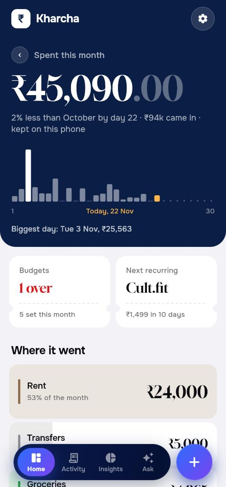
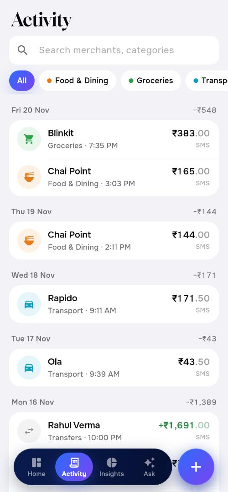
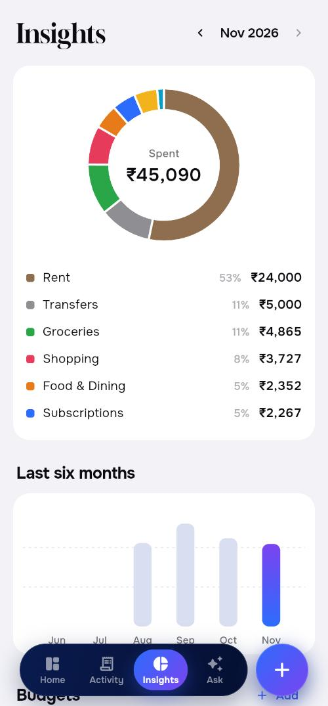
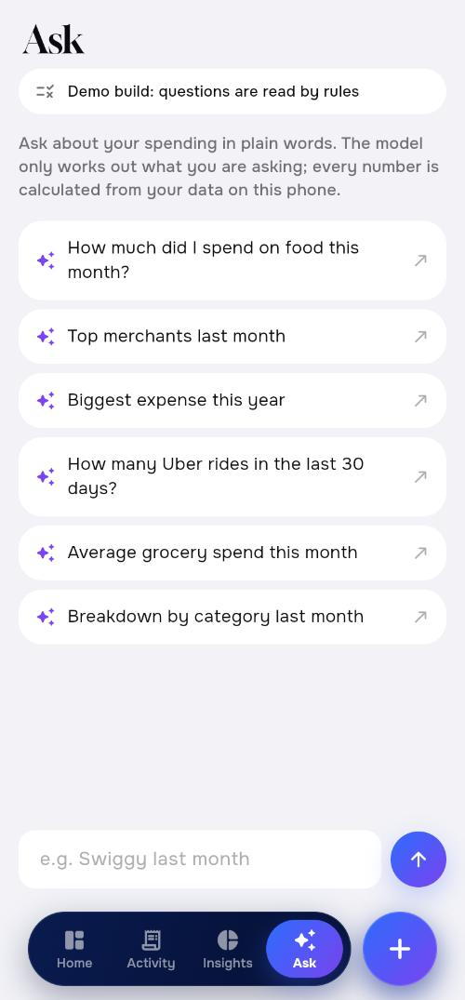
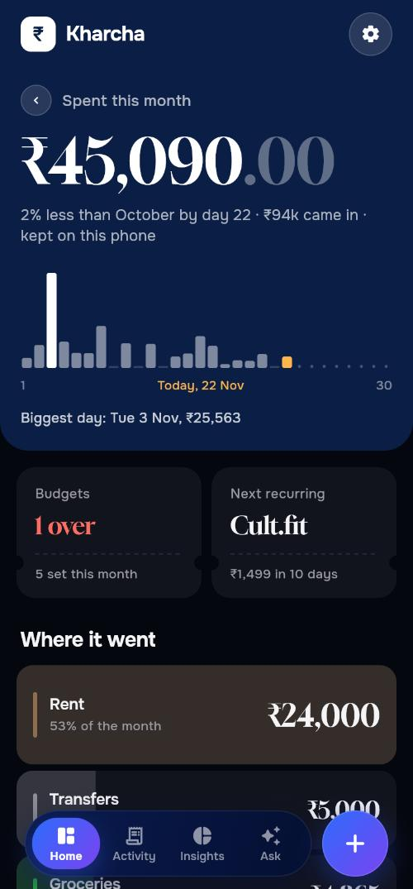
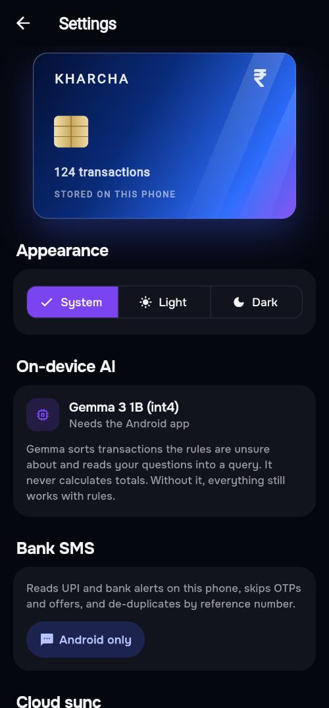
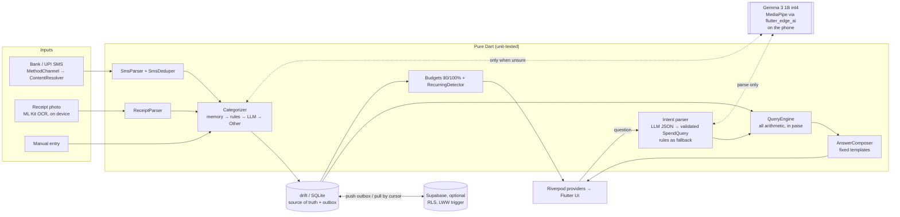

<p align="center"></p>

<h1 align="center">Kharcha</h1>

<p align="center"><b>Every rupee, sorted, on your phone.</b><br>An offline-first Flutter finance app: reads bank and UPI SMS, scans receipts on-device, and answers spending questions with an on-device LLM.</p>

[](https://github.com/alok-kul5/kharcha-finance/actions/workflows/ci.yml)
[](https://github.com/alok-kul5/kharcha-finance/releases/latest)


*Kharcha* (खर्चा) is Hindi for "expense". It is a personal finance app for India that logs spending on its own from bank and UPI SMS, reads shop receipts with on-device OCR, and answers questions like *"how much did I spend on food last month?"*. A small language model, **Gemma 3 1B, runs on the phone**. Nothing is uploaded and nothing costs money: no paid API, no server, no account.

<p align="center">
  
  
  
  
</p>
<p align="center">
  
  
</p>

> Screenshots are from the browser demo build (`flutter run -d chrome`), which runs on generated sample data. The demo has no SMS, camera or Gemma, so its Ask tab shows the rule-based parser.

**[Try it in the browser](https://alok-kul5.github.io/kharcha-finance/)**: the same app compiled for the web, on a month of demo data. SMS reading, receipt scanning and Gemma need the Android build.

**[Download the APK for Android (arm64)](https://github.com/alok-kul5/kharcha-finance/releases/download/v1.0.1/kharcha-v1.0.1-arm64.apk)**: Android 7.0+, fits nearly every phone from recent years, sideload it. Older 32-bit phones, emulators and a universal build are on the [release page](https://github.com/alok-kul5/kharcha-finance/releases/latest). It is not on the Play Store, because the developer account costs money.

---

## Features

| | |
|---|---|
| **Automatic SMS logging** | Reads bank and UPI alerts (with permission, after an explanation) and parses them with a pure-Dart parser: debited/credited/spent/sent/received, `Rs.` `Rs` `INR` `₹`, Indian digit grouping (`1,25,000.00`), masked accounts (`a/c XX1234`, `A/C *1234`, `Card x5678`), UPI references, VPAs and available balances. It skips OTPs, offers, collect requests, failed and scheduled debits. **De-duplicated by UPI/bank reference number**, because banks and UPI apps often send the same transaction twice. |
| **Receipt scanning** | Takes a photo, runs Google ML Kit text recognition **on the device**, then a pure-Dart receipt parser picks out the total (it tells *Grand Total* from *Sub Total*, taxes, savings and item counts), the merchant and the date. You check the fields before saving. |
| **On-device AI categories** | Rules and remembered merchants first. Gemma is asked **only when those are unsure**, and its answer is **validated against a fixed category list**, so the model can never invent a category. |
| **Ask about your spending** | Gemma turns the question into a structured query: metric, category, merchant and date range. **Every number is computed in Dart**, and the reply is a template filled with those numbers. When the model isn't downloaded, a rule-based intent parser does the same job. |
| **Budgets with alerts** | A monthly limit per category, with local notifications at **80% and 100%**. Each threshold fires once a month, and jumping straight past 100% sends one alert, not two. |
| **Recurring payments** | Detects subscriptions, rent and SIPs: the same normalised merchant (`NETFLIX.COM` = `netflix.upi@hdfcbank`), amounts within 15% of the median, and a regular weekly, monthly, quarterly or yearly interval. Shows the next due date and the monthly cost. |
| **Charts** | Cumulative spend this month against last month on the hero, a category donut, and six-month bars (fl_chart). |
| **Offline first** | drift/SQLite is the source of truth. **Optional** Supabase sync uses an outbox, push and pull, and last-write-wins. It is switched on only by `--dart-define`s; without them the app is fully local. |
| **Design** | Material 3 with iOS-style grouped neutrals, a deep-blue animated hero, a blue-to-violet brand gradient with glow, a floating tab bar with a sliding pill, amounts that count up in tabular figures, a code-drawn card with a light sweep, Cupertino transitions, bouncing scroll, a motion-token system with a reduced-motion fallback, and **a full dark mode**. |

## Architecture



```
lib/
  domain/      money (integer paise, Indian grouping), models, the fixed kCategories
  parsing/     sms_parser, receipt_parser, dates, merchant normalisation
  ai/          llm (interface), categorizer, query + intent_parser, query_engine, assistant
  insights/    budgets (80/100% alerts), recurring detection
  data/        LedgerStore interface, drift implementation, in-memory twin
  sync/        sync_engine (outbox, push/pull, LWW), supabase_remote
  platform/    device services: SMS, OCR, notifications, Gemma (native) + browser stand-ins
  services/    ingest (SMS → parse → dedupe → categorise → store), budget watcher
  state/       Riverpod providers
  screens/ widgets/ theme/   the UI
supabase/migrations/          table, LWW trigger, RLS policies
```

Every device feature sits behind a small interface (`SmsInbox`, `ReceiptScanner`, `LocalNotifier`, `ModelManager`, `LlmClient`, `RemoteStore`, `LedgerStore`). The logic is plain Dart and is tested without a phone, and the same app runs in a browser as a demo.

## How the on-device LLM is used, and why it never does maths

Small models are good at reading language and bad at arithmetic, and they can hallucinate confidently. Kharcha only gives the model jobs whose output can be **checked**:

**1. Categorising, as a last resort.** For each new transaction:

1. **Memory**: if you have re-filed this merchant before, use your choice.
2. **Rules**: about 160 keyword rules (`swiggy` → Food & Dining, `bescom` → Bills & Utilities, a person's VPA → Transfers, …). The longest keyword wins, so "Amazon Prime" is a subscription, not shopping.
3. **Gemma**, only if the rules are unsure. The prompt lists the allowed categories and asks for one name back. `validateLlmCategory` accepts the answer only if it maps to exactly one entry in `kCategories` (it tolerates quotes, "Category:" prefixes, "bills and utilities"). A hedge like "Food or Groceries", or an invented category, is rejected.
4. **Other**, if nothing else works. Each transaction records *why* it got its category (`rule`, `memory`, `llm`, `user`), and the UI shows it.

**2. Reading questions, never answering them.** The model gets the question and today's date, and must return JSON like:

```json
{"metric": "total", "direction": "debit", "category": "Food & Dining", "merchant": null, "period": "last_month"}
```

- `extractJsonObject` finds the first balanced `{…}` even when it is wrapped in prose or code fences.
- Each field is validated on its own: `metric` must be a known enum, `category` must be in `kCategories`, and `period` must be a named period (`this_month`, `last_7_days`, …), a month number, or a custom `start`/`end`. **Dates are resolved in Dart**, so the model never does date arithmetic. Any invalid field falls back to what the rule parser read from the same question.
- `QueryEngine` filters the local transactions and computes totals, counts, averages, the largest payment and rankings in **integer paise**. `AnswerComposer` puts those numbers into a fixed sentence.

So when the model replies `You spent Rs 99999! {"metric":"total",…}`, the 99999 is thrown away (there is a test for exactly this). Each answer bubble shows whether Gemma or the rules read the question, how many transactions the number came from, and the parsed query.

**The model itself** is Gemma 3 1B instruction-tuned, int4 quantised, as a MediaPipe `.task` file (about 550 MB), run through [`flutter_edge_ai`](https://pub.dev/packages/flutter_edge_ai) (the successor of `flutter_gemma`) with the MediaPipe engine, on the CPU with temperature 0.1 and top-k 1. It downloads once, from Settings, and then works offline. The model is gated on Hugging Face, so you accept Google's licence on the [model page](https://huggingface.co/litert-community/Gemma3-1B-IT) with a free account and paste a free read token. **Without the model, everything still works** through the rule paths.

## Testing

```powershell
flutter test
```

85 tests, all running without a device:

- `test/parsing/sms_parser_test.dart`: 20 synthetic messages in SBI, HDFC, ICICI, Axis, Kotak, PNB, Bank of Baroda, IDFC, Yes and card-issuer formats, 9 messages that must be rejected (OTP, offers, collect requests, failed, mandates, bills due), and de-duplication by reference and by amount, account and minute.
- `test/parsing/receipt_parser_test.dart`: restaurant, supermarket and pharmacy slips; the total on the next line; decimal commas; lakh grouping.
- `test/ai/`: the categoriser and the assistant against a **scripted fake LLM**: rules first, invalid output rejected, a crashing model, JSON in fences, field-by-field fallback, and the "model tries to answer" case.
- `test/insights/`: budget levels at 79/80/99/100%, alerts firing once per month, recurring detection (monthly with drifting dates, merchant spellings, weekly, yearly, and four negative cases).
- `test/sync/`: two devices and a **fake remote** that applies the same rules as the Supabase table: push/pull, coalesced edits, LWW in both sync orders, tombstones, offline retry, the cursor.
- `test/widget/`: the real app shell on the in-memory store: tabs, search, Ask, manual add with auto-categorising, and dark mode.

CI ([`.github/workflows/ci.yml`](.github/workflows/ci.yml)) checks that the drift code is regenerated, then runs `flutter analyze` and `flutter test`, then `flutter build apk --release`. Pushing a `v*` tag publishes a GitHub Release with the APK attached.

## Run it

Requirements: Flutter 3.50 (Dart 3.14). Building the APK also needs the Android SDK; CI builds it, so you don't need it locally.

```powershell
flutter pub get
```

```powershell
flutter run -d chrome
```

```powershell
flutter build apk --release
```

The browser build is a demo with generated data. The Android app starts empty: tap **+** to import SMS, scan a receipt, or add a transaction. If you change `lib/data/database.dart`, regenerate the drift code with `dart run build_runner build`.

## Optional: sync with a free Supabase project

Sync is off by default and the app never needs it. To turn it on:

1. Create a free project at [supabase.com](https://supabase.com).
2. **Authentication → Sign In / Providers →** enable **Anonymous sign-ins**. Each install signs in anonymously; row level security keeps everyone's rows separate.
3. **SQL Editor →** run [`supabase/migrations/20261120000000_kharcha_records.sql`](supabase/migrations/20261120000000_kharcha_records.sql), or use `supabase db push` with the CLI. It creates `kharcha_records`, a last-write-wins trigger and RLS policies.
4. Copy the project URL and the publishable (anon) key from **Project Settings → API**, then build with them:

```powershell
flutter build apk --release --dart-define=SUPABASE_URL=https://YOUR-PROJECT.supabase.co --dart-define=SUPABASE_ANON_KEY=YOUR_PUBLISHABLE_KEY
```

For CI, add `SUPABASE_URL` and `SUPABASE_ANON_KEY` as repository secrets. The workflow passes them through when they exist.

**How sync works.** Every local write updates `updated_at` and adds an outbox row. A sync pushes the *current* version of each outboxed record (ten edits to one record go up once), then pulls everything after a server-assigned `seq` cursor and applies a record only if it is newer than the local copy. The server enforces the same rule in a `BEFORE UPDATE` trigger, so an older write can't overwrite a newer one whichever device syncs first. Deletes are soft (tombstones), so they sync too. It runs on launch, on resume and every five minutes, and a failure just leaves the outbox for next time.

## Privacy

- SMS are read on the phone. Only completed transactions are stored, with masked accounts. OTPs and personal messages are skipped.
- Receipt OCR (ML Kit) and Gemma run on the device.
- The only network calls are the one-time model download from Hugging Face and your own Supabase project, if you set one up.
- No analytics, no ads, no account.

## Notes and limits

- The release APK is signed with the CI runner's debug key, which is fine for sideloading a portfolio build. Because each CI run has a different key, uninstall before installing a newer APK.
- Each release has per-ABI APKs (`arm64`, `armv7`, `x86_64`) and a universal one. The arm64 APK is the small one most phones need; the universal APK bundles the native MediaPipe and ML Kit libraries for every CPU type, so it is several times larger.
- `READ_SMS` is a restricted permission on the Play Store. That is one more reason this app ships through GitHub Releases.
- SMS formats change. The parser covers the common shapes and is easy to extend: add a sample to `sms_parser_test.dart` first.

## License

MIT. Gemma is provided under Google's [Gemma Terms of Use](https://ai.google.dev/gemma/terms); the model is downloaded by the user and is not shipped in this repository or the APK.

---

<sub>One of twelve projects by [Alok Kulkarni](https://alok.is-a.dev): [Hearth](https://github.com/alok-kul5/hearth-iot) home sensors · [Headway](https://github.com/alok-kul5/headway-transit) transit data · [Vigil](https://github.com/alok-kul5/vigil-soc) security triage · [Loupe](https://github.com/alok-kul5/loupe-vision) defect inspection · **Kharcha** personal finance · [Stockroom](https://github.com/alok-kul5/stockroom-inventory) inventory · [Quietwire](https://github.com/alok-kul5/quietwire-villa) smart home design · [Canopy](https://alok.is-a.dev/canopy/) coffee storefront · [Picket](https://github.com/alok-kul5/picket) detection rules · [Warden](https://github.com/alok-kul5/warden-iac) cloud IaC scanning · [Marquee](https://github.com/alok-kul5/marquee-recs) recommendations · [Kestrel](https://github.com/alok-kul5/kestrel) fraud detection.</sub>
